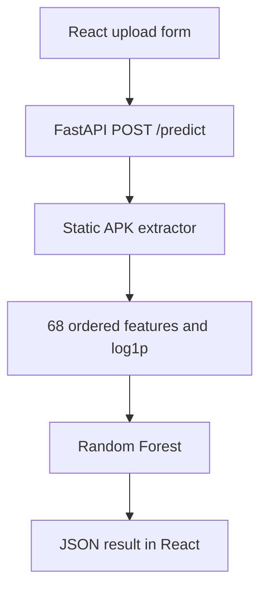

# Guardroid

**An Android APK classifier built around a practical question: can a model trained on a table of Android features make a meaningful prediction from a file someone uploads?**

Guardroid connects a React interface to a FastAPI backend that extracts static features from Android application packages and sends them to a trained Machine Learning Model based on Random Forest. The project spans exploratory data analysis, model selection, and deployment. The hardest part was reproducing at inference time what each training column measured.

> **Project status:** The upload-to-prediction flow works end to end. The Random Forest reached approximately **97% accuracy on the Droidware evaluation split** used during development. That result is for dataset rows. Performance on newly uploaded APKs still needs separate evaluation because the extractor uses project-defined counting rules.

## Architecture



| Layer | Tools | Role |
| --- | --- | --- |
| Training | pandas, NumPy, scikit-learn, Jupyter | Explore the dataset, compare models, and export the chosen estimator |
| Extraction | Androguard, Python ZIP handling | Read the manifest, DEX files, and archive entries |
| Serving | FastAPI, Uvicorn, joblib | Accept APKs, load the model, and return predictions |
| Interface | React, TypeScript, Vite | Guide the user from file selection to the prediction result |

## 1. Choosing the dataset and defining the target

I started with **Droidware**, a labeled Android malware dataset that let me train a tabular classifier before building an APK processing service. I split the feature list into groups of roughly ten to make the review manageable. I also considered TUANDROMD and LAMDA when reproducing Droidware's extraction rules became difficult, then stayed with Droidware to build on the training work already completed.

The task is **supervised binary classification**. Each row describes one APK, and `Label` is the target: benign or malicious. I excluded `Sha256` from the model inputs because it identifies a file. It is useful for matching an APK to its dataset row and checking for duplicate files. The model uses **68 feature columns**.

## 2. Understanding and preparing the features

I grouped features by what an extractor can observe: requested permissions, manifest components, references to Java or Android types, method table entries, and bytecode call sites. A feature name gives a clue about its meaning, but the counting unit matters. For example, a DEX file can list `CertificateFactory` even if the class is never called at runtime. When inspecting a sample APK, I counted three method table entries named `getDeviceId` and twelve static calls to methods with that name. These numbers describe different properties of the same file.

I inspected ranges, sparse columns, and unusual values before training. For a feature with mostly zeros, an interquartile range of zero can flag every nonzero value, including legitimate observations. I used `log1p` to compress large counts while preserving zeros. The deployed model expects the same transformation on all 68 input columns, applied once after extraction.

I used annotated Pearson heatmaps to inspect relationships among features and with the target, and scatter plots colored by class to see how example groups overlapped. A correlation as high as 0.97 prompted a review for redundancy. Column removal still depends on how the model performs with and without the feature. A weak Pearson correlation can hide threshold effects or interactions that a tree can use.

## 3. Selecting the model

| Experiment | Why I tried it | What it let me assess |
| --- | --- | --- |
| Logistic Regression with standardization | Establish a simple baseline on features with different scales | How much separation an additive model could capture |
| Shallow and deeper Decision Trees | Inspect rules and compare different levels of complexity | Whether thresholds and feature combinations helped, and whether increased depth risked overfitting |
| Random Forest | Combine trees trained on different samples and feature subsets | Whether averaging many trees improved the baseline |

I used a stratified split to preserve the class proportions and inspected classification reports and confusion matrices. For a malware classifier, **recall** measures how many malicious APKs the model catches, while **precision** measures how many flagged APKs are actually malicious. These give context to accuracy by exposing missed malware and false alarms.

I chose the **Random Forest**, starting with **100 trees** as a practical balance between stability and compute. I considered how Gradient Boosting builds trees sequentially, but selected the forest based on the result I observed. I exported the trained model to `guardroid_model.joblib`.

## 4. Turning an APK into a model input

Androguard reads the manifest and bytecode without installing or executing the APK. The extractor assembles raw integers in the training column order. The predictor then applies the same preprocessing used in the notebook.

| Feature family | Guardroid measurement |
| --- | --- |
| Permission columns | Count matching permission declarations by exact permission name. `ReadUserDictionary` is a 0/1 presence flag. |
| Manifest components | Count matching declarations. For example, `ServiceLifecycle` uses the number of declared services. |
| Named Java and Android types | Count DEX files listing the exact type descriptor. |
| `*CallCount` | Count static invocation instructions by target method name across DEX files. |
| `*Occurrences` | Count matching names in DEX method tables. |
| Native code and classes | Count native `.so` entries for `NDK` and use DEX class definitions as a proxy for `TotalJavaFile`. |
| Features without an agreed rule | Use the project's zero fallback for the numeric vector. |

A fallback zero has the same numeric value as a measured zero, but it carries less evidence. To validate extraction against Droidware, compare each feature with the corresponding dataset row for several APKs matched by SHA-256. This is separate from checking that an upload returns a prediction.

## 5. Designing the API

The backend loads the trusted joblib model at startup and reuses it for predictions. The route receives the APK as multipart form data under the field name `file`. It checks the extension and upload size, writes the file to a per-request temporary directory, and passes the path to the predictor. The temporary directory is cleaned up after processing.

| Endpoint | Purpose |
| --- | --- |
| `GET /health` | Check API availability |
| `POST /predict` | Upload an APK and predict from extracted features |
| `POST /predict/demo` | Development route used to verify the upload and result flow with generated features, if retained |

The demo was useful while the extractor was still being developed. Generating the mock vector inside the handler produced fresh test input on each upload. The frontend could be tested against a real API response before the file's contents supplied the features.

## 6. Designing the frontend

The React site introduces Guardroid with paired green and red Android mascots. Those same visual cues carry into the scan result. The upload flow gives the user a clear sequence: choose or drop an APK, start the scan, and read the result or error.

The frontend sends a `POST` with a browser-built `FormData` body. FastAPI parses the multipart upload through `python-multipart`. For local development with separate Vite and FastAPI origins, the backend's CORS configuration allows the exact origin used by the frontend.

## Project layout

The paths below reflect the structure used during development. Run the frontend commands from the directory containing its `package.json`.

```text
├──backend/
    ├── app.py                          # FastAPI app and model setup
    ├── config.py                       # Artifact paths and upload limits
    ├── routes/routes.py                # Health and prediction endpoints
    ├── schemas/apk.py                  # Feature schema
    ├── services/
    │   ├── extractor.py                # APK to raw feature counts
    │   ├── process.py                  # Validation, feature order, and log1p
    │   └── predictor.py                # Model inference
    ├── artifacts/
    │   └── guardroid_model.joblib
    ├── notebook/
    │   ├── main.ipynb
    │   └── dataset.csv
├──frontend/
    ├── src/
    │   ├── assets/              # Mascots, logos, and other visual assets
    │   ├── components/          # Reusable UI components
    │   ├── pages/               # Page-level views
    │   ├── App.tsx              # Root React component
    │   ├── App.css              # App styles
    │   ├── index.css            # Global styles
    │   ├── main.tsx             # Mounts React into index.html
    │   └── vite-env.d.ts        # TypeScript declarations for Vite
    ├── .gitignore
    ├── eslint.config.js         # Linting rules
    ├── index.html               # HTML entry point
    ├── package.json             # Dependencies and npm scripts
    ├── package-lock.json        # Locked dependency versions
    ├── tsconfig.app.json        # TypeScript settings for frontend code
    ├── tsconfig.json            # Root TypeScript configuration
    ├── tsconfig.node.json       # TypeScript settings for build tooling
    └── vite.config.ts           # Vite development and build configuration
├──README.md
├──requirements.txt
```

## Run locally


From `backend/`, activate your Python environment, install dependencies, and start the API.

```bash
.venv\Scripts\activate
cd .\backend\
python -m pip install -r requirements.txt
python -m uvicorn app:my_app --reload
```

Open an other terminal to run the UI:

```bash
cd .\frontend\
npm install
npm run dev
```

To test the API independently of React, open [Swagger UI](http://127.0.0.1:8000/docs). You can also try Postman requests to simulate how the server works

## What would make the results stronger?

- **Verify feature parity.** Use hash-matched Droidware rows to check the extractor and record which columns rely on proxies or fallback values.
- **Evaluate the deployed pipeline.** Run previously unseen labeled APKs through the upload endpoint and report malware precision, recall, and false positives.
- **Test generalization.** Where metadata permits, evaluate on newer APKs or malware families held apart from training to see how performance changes.

**Built by Achraf Hendkias**